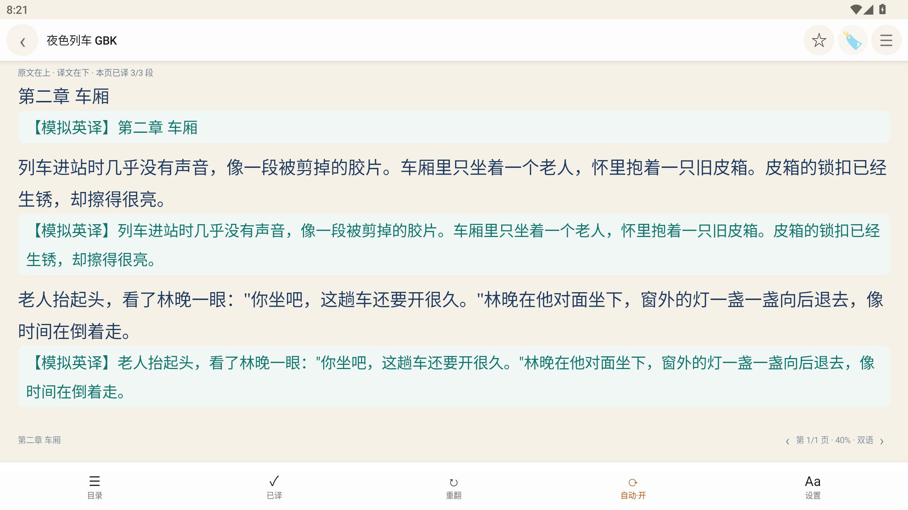
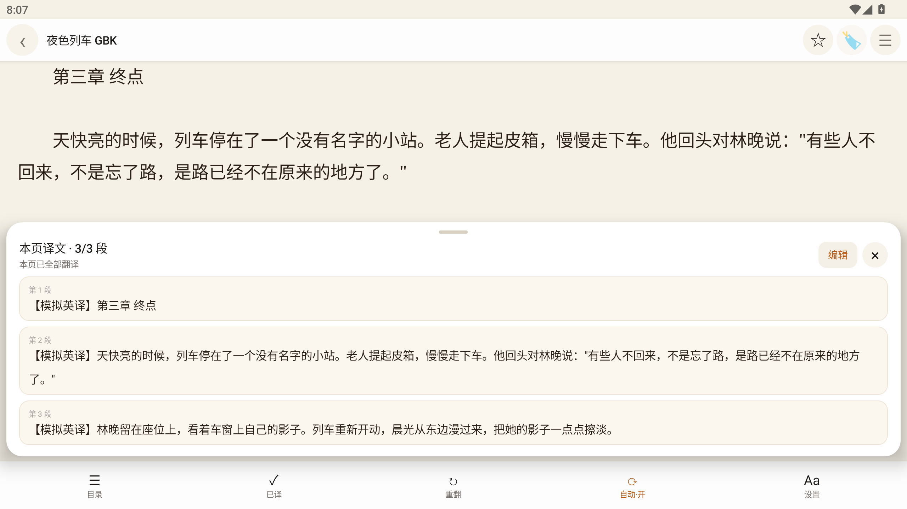
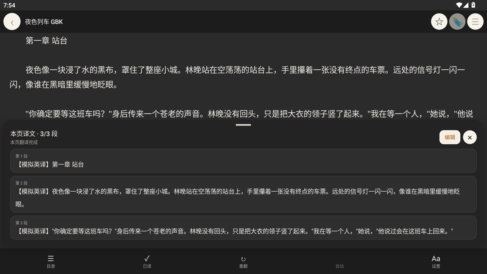
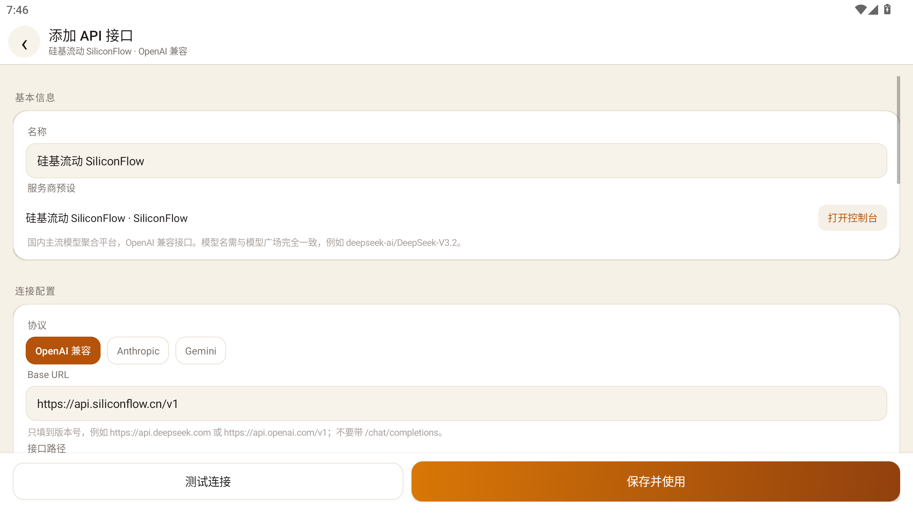
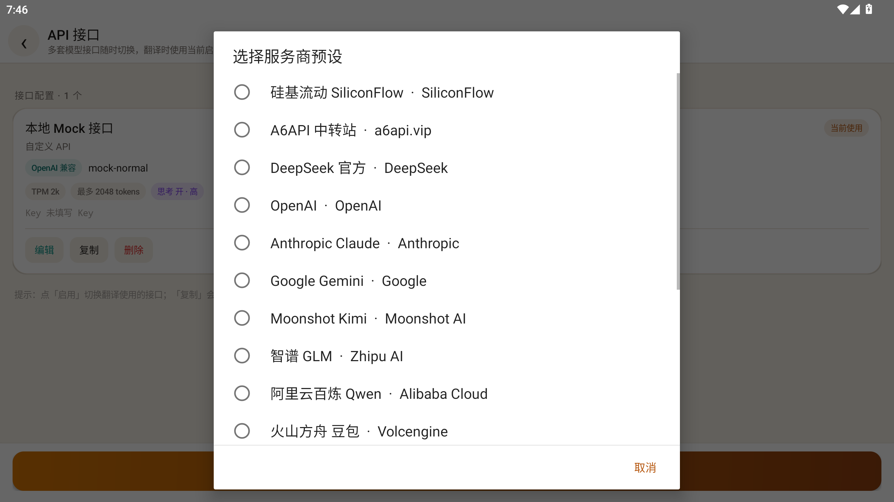

# 译读 · TXT 小说实时翻译阅读器（Android）

一个可以打开本地 TXT 小说、按页调用大模型 API 流式翻译的 Android 阅读器。支持硅基流动、A6API 中转站、DeepSeek 官方、OpenAI、Claude、Gemini、Kimi、GLM、Qwen 等主流接口，也支持任意自定义/中转网关；译文、阅读进度、书签、收藏与术语表全部保存在本机。

- **下载安装**：请前往本仓库的 **Releases** 页面下载最新签名 APK（发布时上传，不提交到源码仓库）
- **当前版本**：1.1.0（versionCode 2）
- **包名**：`com.yidu.novel`
- **系统要求**：Android 8.0+（minSdk 26，targetSdk 34）
- **界面语言**：简体中文
- **源码构建**：见 [从源码构建](#从源码构建)，无需 Gradle
- **源码**：本仓库 `app/`；无需 Gradle，使用 `build.ps1` 即可编译签名

> 本 README 中的截图使用**本地 mock 接口**演示，所以译文里带有「【模拟译】/【模拟英译】」字样；正式使用时填入你自己的 API Key，译文由真实模型生成。

---

## 目录

- [功能一览](#功能一览)
- [界面预览](#界面预览)
- [快速开始](#快速开始)
- [API 配置说明](#api-配置说明)
- [翻译设置与术语表](#翻译设置与术语表)
- [阅读与导出](#阅读与导出)
- [数据、隐私与安全](#数据隐私与安全)
- [从源码构建](#从源码构建)
- [测试记录](#测试记录)
- [需求核对表](#需求核对表)
- [已知限制](#已知限制)
- [目录结构](#目录结构)

## 功能一览

### 阅读

- 通过系统文件选择器导入 `.txt` 小说，自动识别 **UTF-8 / UTF-8 BOM / UTF-16 / GB18030(GBK)** 编码。
- 自动合并硬折行、按段落分块、识别中英文常见章节标题（`第一章`、`第1章`、`Chapter 1`、`序章/楔子/番外` 等）。
- 精确分页（依据字号、行距、屏宽计算），支持点击左右翻页、滑动翻页、音量键翻页、上一章/下一章。
- 字体大小 14–34sp、宋体/黑体/等宽、文字颜色与背景颜色（内置纸黄/纯白/护眼绿/夜间深色 + 自定义 `#RRGGBB`）、行距、段间距、首行缩进。
- 章节目录、阅读进度百分比、上次阅读位置、多本书各自独立进度、书签、收藏夹。
- **双语对照阅读模式（1.1.0 新增）**：原文段落在上、译文段落在下逐段排列，译文随流式翻译实时回填，方便边读边核对翻译质量；可在阅读菜单、快读设置 Aa、设置页随时切换，切换后自动记忆。
- 退出应用或切换书籍后再次打开，自动回到上次阅读位置；已完成译文不会丢失。

### 翻译

- 对**当前页**调用大模型 API，按块（段落）流式翻译，逐段回填。
- 翻页后可**自动翻译**（底部「自动」开关），也可随时手动按「翻译」；「重翻」会丢弃本页旧译文重新翻译。
- 译文面板流式显示；支持点按段落**编辑并保存**；可一键复制本页译文。
- 单次最大输出 token 多档可选（512/1024/2048/4096/8192/16384/32768/65536/**不限制**）。
- TPM 限流控制（不限/2k/5k/10k/20k/50k/100k/自定义），按 60 秒滑动窗口排队并在界面提示等待秒数；低 TPM 时自动缩小每批翻译量。
- 输出被截断（`finish_reason=length` / `MAX_TOKENS`）或返回段落数不一致时，自动拆分批次重试。
- 内置三档质量提示词（高质量·文学精译 / 标准·通顺可靠 / 快速·省流），均可编辑、可恢复默认；支持保存多组自定义提示词。
- 独立的「保留原文标点」开关：开启时尽量沿用原文引号、省略号、破折号等；关闭时按目标语言标点习惯重排。
- 原文语种支持**自动识别**或手动指定；译文语种支持 20 种语言。
- 多组术语表（每行 `原文=译文`），可启用/停用，自动附加到翻译提示词。
- DeepSeek 思考模式独立开关（低/高/最高推理强度），按官方文档发送
  `{"thinking":{"type":"enabled"}}` 与 `reasoning_effort`；该开关同样适用于**中转站/自定义接口**中支持 thinking 的 DeepSeek 模型。
- 按原文的段落、空行与章节结构导出译文，支持「仅译文」和「中英双语对照」两种格式；未翻译段落可保留原文。

### API 配置

- 内置 16 个服务商预设：**硅基流动 SiliconFlow**、**A6API 中转站**、DeepSeek 官方、OpenAI、Anthropic Claude、Google Gemini、Moonshot Kimi、智谱 GLM、阿里云百炼 Qwen、火山方舟豆包、百度千帆、腾讯混元、MiniMax、OpenRouter、Groq、Ollama 本地，另有**自定义 API**。
- 每个预设自动填充 Base URL、接口路径、推荐模型与控制台链接，可手动修改。
- 三种协议：OpenAI 兼容、Anthropic Messages、Gemini generateContent；支持自定义请求头 JSON（如 OpenRouter 的 `HTTP-Referer`）、完整 URL 接口路径。
- 可保存**多套 API 配置**并随时切换当前使用项；支持复制、删除、编辑。
- 「测试连接」后台发起真实请求，不需要先保存。
- API Key 使用 Android Keystore 中的 AES-256-GCM 密钥加密后保存，UI 只显示首尾各 4 位掩码。

## 界面预览

| 双语对照模式（原文在上 · 译文在下） | 阅读 + 流式译文面板 |
| --- | --- |
|  |  |

| 书库 / 继续阅读 | 夜间主题 |
| --- | --- |
|  |  |

| 阅读设置 | 阅读模式设置 |
| --- | --- |
|  |  |

| API 列表（多套配置） | API 编辑 / TPM / 最大输出 |
| --- | --- |
|  |  |

| 服务商预设 | 提示词管理 |
| --- | --- |
|  |  |

| 术语表 | 书签 |
| --- | --- |
|  |  |

## 快速开始

1. 安装 `YiDuNovel-1.1.0.apk`（需要允许「安装未知来源应用」）。
2. 首次启动点击右上角「API 待填写」或书库中的「去配置 API」：
   - 点「添加 API 接口」→ 选择服务商预设（例如**硅基流动**或 **A6API**）→ 填入 API Key → 点「测试连接」确认可用 → 「保存并使用」。
3. 返回首页，点「导入 TXT 小说」，选择手机里的 `.txt` 文件。
4. 进入阅读页：
   - 点击屏幕**左侧/右侧**翻页（可在设置中改为滑动或音量键）；
   - 点击屏幕**中间**显示/隐藏菜单；
   - 底部「翻译」翻译本页，「重翻」重新翻译，「自动」开启翻页自动翻译，「Aa」快速调字号/背景/文字颜色；
   - 顶栏 ☆ 收藏，🔖 添加/移除本页书签，☰ 打开目录、书签、导出、语种切换等菜单。
   - 想边读边核对译文：☰ →「切换为双语对照模式」，或 Aa →「双语对照」开关；开启后每段原文下方会实时显示该段译文。
6. 译文面板中点击「编辑」后，点按任意段落即可修改并保存该段译文；右上角 × 关闭面板。
7. 菜单 →「导出译文」→ 选择「仅译文」或「中英双语」→ 选择保存位置即可生成与原文结构一致的 `.txt`。

## API 配置说明

### 常用预设

| 预设 | Base URL / 协议 | 控制台 |
| --- | --- | --- |
| 硅基流动 SiliconFlow | `https://api.siliconflow.cn/v1` · OpenAI 兼容 | https://cloud.siliconflow.cn/account/ak |
| A6API 中转站 | `https://www.a6api.vip/v1` · OpenAI 兼容 | https://www.a6api.vip/?sort=cache_hit_desc#/console/tokens |
| DeepSeek 官方 | `https://api.deepseek.com` · OpenAI 兼容 | https://platform.deepseek.com/api_keys |
| OpenAI | `https://api.openai.com/v1` | https://platform.openai.com/api-keys |
| Anthropic Claude | `https://api.anthropic.com/v1` · Anthropic 协议 | https://console.anthropic.com/settings/keys |
| Google Gemini | `https://generativelanguage.googleapis.com/v1beta` · Gemini 协议 | https://aistudio.google.com/apikey |
| Moonshot Kimi | `https://api.moonshot.cn/v1` | https://platform.moonshot.cn/console/api-keys |
| 智谱 GLM | `https://open.bigmodel.cn/api/paas/v4` | https://bigmodel.cn/usercenter/apikeys |
| 阿里云百炼 Qwen | `https://dashscope.aliyuncs.com/compatible-mode/v1` | https://bailian.console.aliyun.com/?apiKey=1 |
| 火山方舟豆包 | `https://ark.cn-beijing.volces.com/api/v3` | https://console.volcengine.com/ark |
| 百度千帆 | `https://qianfan.baidubce.com/v2` | 千帆控制台 |
| 腾讯混元 | `https://api.hunyuan.cloud.tencent.com/v1` | 混元控制台 |
| MiniMax | `https://api.minimax.chat/v1` | MiniMax 平台 |
| OpenRouter | `https://openrouter.ai/api/v1` | https://openrouter.ai/settings/keys |
| Groq | `https://api.groq.com/openai/v1` | https://console.groq.com/keys |
| Ollama 本地 | `http://127.0.0.1:11434/v1`（手机访问电脑请改为电脑局域网 IP） | https://ollama.com |
| 自定义 API | 自填 Base URL / 接口路径 / 协议 / 请求头 | — |

> A6API 等中转平台可能按令牌分组提供不同的 Base URL。如果测试返回 404，请以控制台提供的实际 Base URL 为准，接口路径保留 `/chat/completions`。模型名必须与平台可用模型完全一致。

### 参数

- **协议**：`OpenAI 兼容` 走 `POST {base}/chat/completions`；`Anthropic` 走 `POST {base}/messages`；`Gemini` 自动拼接 `models/{model}:streamGenerateContent?alt=sse`。接口路径填写以 `http(s)://` 开头的完整地址时优先直接使用。
- **单次最大输出**：限制时发送 `max_tokens`/`maxOutputTokens`；选「不限制」时 OpenAI/Gemini 不发送该字段，Anthropic 使用 64000（协议强制要求）。
- **TPM 限制**：用于适配低 TPM 模型/账号。App 会按估算 token 在 60 秒窗口内排队，状态栏提示「已触发 TPM 限流：等待约 N 秒后自动继续…」。
- **DeepSeek 思考模式**：开启后发送 `thinking:{"type":"enabled"}` 与 `reasoning_effort: low/high/max`，且不再发送 `temperature`；关闭时若识别为 DeepSeek 模型/官方域名，会显式发送 `thinking:{"type":"disabled"}`。按官方文档：https://api-docs.deepseek.com/zh-cn/guides/thinking_mode
  - 中转站配置只要模型本身支持 thinking，同样可以通过此开关启用。
- **自定义请求头**：JSON 对象，例如 `{"HTTP-Referer":"https://example.com","X-Title":"YiDu"}`；格式错误会被忽略。
- **测试连接**：使用当前表单参数发送一条小请求；思考模式或输出上限导致的截断会被识别为「连接成功但响应被截断」。

## 翻译设置与术语表

- **原文语种**：自动识别（按文字脚本判断，同一语言时跳过无意义翻译）或手动指定 20 种语言。
- **译文语种**：默认简体中文，可选繁体中文、英语、日语、韩语、法语、德语、西班牙语、葡萄牙语、俄语、阿拉伯语、意大利语、泰语、越南语、土耳其语、印尼语、印地语、荷兰语、波兰语、乌克兰语。
- **提示词 / 翻译质量**：内置高质量、标准、快速三档；可编辑内置提示词、恢复默认、复制、新建多组自定义提示词；当前提示词可随时切换。
- **可用变量**：`{source_lang}`、`{target_lang}`、`{chapter}`、`{glossary}`。
- **保留原文标点**：独立开关，不依赖提示词。
- **术语表**：可创建多组，每组按行填写 `原文=译文`（也支持 Tab 或英文逗号分隔）；启用后自动拼接进系统提示词，限制总长度避免挤占上下文。

## 阅读与导出

- **翻页方式**：点击左右 / 滑动 / 音量键（音量键在三种模式下均可用）。左右点击区域各占 1/3，中间 1/3 呼出/隐藏菜单。
- **双语对照模式**：开启后当前页按段落纵向排列「原文在上、译文在下」，译文块以青绿色底区分并随流式翻译实时更新；顶部状态行显示「原文在上 · 译文在下 · 本页已译 x/y 段」。可在阅读菜单、Aa 快读设置或设置页切换，模式会被记忆；长按译文块可打开译文面板、重翻本页或复制本段译文。
- **书签**：顶栏 🔖 添加/移除当前页；菜单 →「书签列表」查看全部书籍书签并跳转。
- **收藏夹**：顶栏 ☆ 或书库卡片右上角 ☆；书库顶部「★ 收藏夹」筛选。
- **导出**：菜单 →「导出译文」；会显示已译段落统计。导出文件按原文的段落、空行、章节结构逐段生成；未翻译段落保留原文；可选「仅译文」或「中英双语对照」。导出通过系统「创建文档」保存到你选择的位置（默认 `下载`）。
- **编辑译文**：译文面板「编辑」→ 点按段落 → 修改 → 保存；保存后立即写入本机译文日志并用于后续导出。

## 数据隐私与安全

- App 无账号、无埋点、无统计 SDK、无自建服务器；所有翻译请求直接发送到你填写的 API Base URL。
- API Key 使用 Android Keystore 生成的 AES-256-GCM 密钥加密后存入应用私有 SharedPreferences；列表只显示掩码。
- 书籍文件保存于应用私有目录 `files/books/`；译文使用追加式 JSONL 日志保存在 `files/translations/`，流式翻译每完成一段立即落盘，App 退出/崩溃后已完成译文仍保留。
- `allowBackup=false`，不参与系统云备份；卸载应用会删除本地数据。
- 译文由第三方模型生成，可能存在错误；请勿将本软件用于法律、医疗等高风险场景的唯一依据。

## 从源码构建

本项目**不依赖 Gradle**，使用 Android SDK 自带的 `aapt2 + javac + d8 + zipalign + apksigner` 编译。

### 环境要求

- JDK 17
- Android SDK Platform 35（或更新）
- Android SDK Build-Tools 35.0.0（或更新）
- Windows PowerShell 5.1+ / PowerShell 7

构建工具链体积较大（约 700MB），**不提交到仓库**。可以任选一种方式提供：

```powershell
# 方式 A：设置环境变量
$env:JAVA_HOME = "C:\path\to\jdk-17"
$env:ANDROID_HOME = "C:\path\to\Android\Sdk"

# 方式 B：把工具放到本地 .tools 目录（已被 .gitignore 忽略）
#   .tools\jdk\jdk-17...\
#   .tools\sdk\...
```

### 编译

```powershell
# 在仓库根目录
powershell -NoProfile -ExecutionPolicy Bypass -File .\build.ps1
# 或显式指定路径
powershell -NoProfile -ExecutionPolicy Bypass -File .\build.ps1 -JdkPath "C:\jdk17" -SdkPath "C:\Android\Sdk"
```

Windows 上 `aapt2` 对中文/Unicode 路径支持不佳；如果项目路径含中文，建议建立 ASCII 目录联接后构建：

```bat
mklink /J C:\yidubuild "D:\path\to\yidu-novel"
powershell -NoProfile -ExecutionPolicy Bypass -File C:\yidubuild\build.ps1
```

输出：`YiDuNovel-1.1.0.apk`

构建脚本参数：`-SkipSign` 只生成未签名包；`-OutName` 指定输出文件名；`-KeystorePath` / `-KeyAlias` 指定签名文件与别名。

### 签名（重要）

源码仓库**不包含签名密钥**。首次构建请自行生成：

```powershell
powershell -NoProfile -ExecutionPolicy Bypass -File .\tools\create-keystore.ps1
# 然后设置密码环境变量（只在本地）
$env:YIDU_KS_PASS = "你的密钥库密码"
powershell -NoProfile -ExecutionPolicy Bypass -File .\build.ps1
```

- 生成的 `keystore/*.jks` 已被 `.gitignore` 忽略，**切勿提交**；请把密码和 keystore 备份到密码管理器/私有位置。
- 官方发布 APK 使用作者私钥签名；其他人用自己密钥重建的 APK 不能覆盖安装官方版（会提示签名冲突）。
- 修改包名或使用自己的签名后再发布你自己的版本。

### 主要源码结构

```
app/
  AndroidManifest.xml
  java/com/yidu/novel/
    App.java  BaseActivity.java  MainActivity.java  ReaderActivity.java
    SettingsActivity.java  ApiProfilesActivity.java  ApiEditActivity.java
    PromptProfilesActivity.java  PromptEditActivity.java
    GlossaryListActivity.java  GlossaryEditActivity.java  BookmarksActivity.java
    model/    ApiProfile ProviderPreset PromptProfile Glossary Book Bookmark
    store/    AppStore BookRepository TranslationStore SecretBox
    net/      LlmClient TranslationEngine PromptBuilder StreamJsonParser
              TokenLimiter TokenEstimator OutputGuard LlmException
    util/     Novel TextUtil Exporter Defaults Lang Ui
  res/        图标、主题、颜色、字符串
build.ps1
tools/
  create-keystore.ps1       本地生成签名密钥（不会提交 keystore）
  mock_server.js            本地 OpenAI 兼容 mock（流式/截断/429/thinking）
  adb_ui.ps1                adb UI 自动化辅助脚本
  samples/                  测试小说（UTF-8 英文 / GBK 中文）
  qa-core/                  JVM 核心逻辑与网络层测试
preview/                    界面预览图（README 使用）
```

## 测试记录

测试环境：Android 12（MuMu 模拟器，x86_64）+ 本地 mock 大模型服务（`adb reverse` 将手机 `127.0.0.1:8799` 转发到电脑）。

| 测试 | 结果 |
| --- | --- |
| 核心逻辑 JVM 测试（编码/章节/分块/分页/JSON 流式解析/提示词/导出/防复读/token 估算） | **186 / 186 PASS** |
| 网络层 JVM 测试（OpenAI/Anthropic/Gemini × 流式/非流式、thinking 字段、max_tokens、错误码、取消、超时限流、Gemini 自定义完整 URL） | **263 / 263 PASS** |
| TXT 导入 | UTF-8 英文样例、GBK 中文样例均正确识别并分章 |
| 流式翻译 + 逐段落盘 | 面板 3/3 段完成，`files/translations/*.jsonl` 即时写入 |
| 自动翻译 + 音量键翻章 | 翻页后自动发起新页翻译 |
| TPM 2000 限流 | 状态显示「等待约 58 秒后自动继续」，批次自动缩小 |
| 输出截断 | mock 返回 `finish_reason=length` 后半批失败、自动拆分为 1+1 段重试并全部完成 |
| 重翻本页 | 清空本页旧译文并重新请求 |
| 译文编辑保存 | 修改第 1 段后 JSONL 立即追加新记录 |
| 退出/重启续读 | 强杀进程后重新打开：回到上次章节、页，译文与「已译」状态保留 |
| 导出（仅译文 / 双语） | 导出文件保留原文章节、段落、空行；未译段落回退原文 |
| 书签 / 收藏夹 / 目录 / 夜间主题 / 字号 / 颜色 | UI 操作验证通过 |
| 双语对照模式 | 原文在上译文在下逐段渲染；本页 3/3 段译文实时内联展示，自动翻译/翻页/切换回原文模式均正常；重启 App 后仍保持所选模式 |
| API 多套配置与 Key 加密 | 保存 2 套接口；SharedPreferences 中 Key 为 `v1:` AES-GCM 密文，无明文 |
| DeepSeek 中转开启/关闭思考 | mock 日志确认：开启发送 enabled + effort 且无 temperature；关闭发送 disabled；中转自定义接口同样生效 |
| 最大输出「不限制」 | 请求体无 `max_tokens`；限制时按选择发送 |
| Release 构建 | 无 `debuggable`，签名通过 `apksigner verify`，真机/模拟器安装覆盖正常 |

> QA 详情报告：[`tools/qa-core/REPORT.md`](tools/qa-core/REPORT.md)、[`tools/qa-core/NET-REPORT.md`](tools/qa-core/NET-REPORT.md)。

## 需求核对表

| # | 需求 | 实现位置 |
| --- | --- | --- |
| 总 | 打开 TXT 小说，用模型 API 实时翻译当前页；翻页后自动或手动翻译 | 书库导入；`ReaderActivity` 分页 + `TranslationEngine` 流式；底部「自动/翻译」 |
| 1 | 主流大模型 API 输入界面，必须含硅基流动与 A6API；自定义 API；保存多套 | `ProviderPreset`（16 预设，含 A6API 控制台链接）；`ApiProfilesActivity` / `ApiEditActivity` |
| 2 | TPM 控制适配低 TPM 模型 | API 配置 TPM 档位 + `TokenLimiter` 60s 滑动窗口 + 动态批次缩小 |
| 3 | 高中低三档内置提示词、可自定义、保留原文标点独立开关 | `Defaults`、`PromptProfilesActivity`、`PromptEditActivity`；`punctuation` 设置项 |
| 4 | 原文/译文语种，原文可自动识别 | `SettingsActivity` 语种选择；`Lang.detect` 与自动跳过同语言页面 |
| 5 | 单次最大输出 token 多档含不限制 | `ApiEditActivity` 对话框选项；`LlmClient` 按协议省略/发送 |
| 6 | 用户可储存多组自定义提示词 | `PromptProfilesActivity` / `PromptEditActivity`，内置+自定义统一存储、可复制/删除/切换 |
| 7 | DeepSeek 推理开关，且适用中转站 | `ApiEditActivity` 思考模式开关 + 强度；`LlmClient` thinking/reasoning_effort；也适用于自定义接口 |
| 8 | 术语表，可保存/编辑多组 | `GlossaryListActivity` / `GlossaryEditActivity`；`AppStore.glossaryPrompt` 注入提示词 |
| 9 | 重翻本页 | 底部「重翻」/ 菜单；`TranslationEngine` force 模式 |
| 10 | 流式输出，完成后可编辑保存译文 | 译文面板逐段流式回填；编辑对话框保存到 `TranslationStore` |
| 11 | 退出后继续阅读进度，已完成译文保留 | `Book.lastBlock/lastReadAt` + 译文 JSONL 追加日志；启动恢复 |
| 12 | 导出译文格式结构按原文 | `Exporter` 按 paragraphs/blocks 生成，保留空行与章节标题，支持双语 |
| 13 | 一般小说阅读器功能：字号、字体颜色、背景色、书签、收藏、上次阅读 | `ReaderActivity` + `SettingsActivity` + `BookmarksActivity` + 书库收藏夹/继续阅读 |
| 14 | 新增：原文在上、译文在下的阅读模式，便于实时检查翻译质量 | `ReaderActivity.renderBilingualPage()`：逐段原文+译文块，流式译文实时回填；阅读菜单/Aa/设置三处可切换并记忆 |

## 已知限制

- 翻译质量与速度取决于你配置的模型与网络；提示词、术语表只能约束模型，不能保证 100% 稳定。
- 部分中转平台会按令牌分组提供不同 Base URL，或限制模型名；遇到 404/401 请以平台控制台为准。
- 本章没有章节标题的超长 TXT 会被当作单章处理，首次分页在低端设备上可能需要数秒；建议使用带章节标题的 TXT。
- 译文按段落对齐；模型返回段落数严重不一致时会自动拆分重试，仍可能有个别段落未完成，可点「重翻」重试。
- 目前只有简体中文界面；APK 使用自签名测试证书，未上架应用商店。
- 本地 mock 接口仅用于开发/演示，不包含在任何正式请求中；App 不会向除你填写的 API 地址以外的服务器发送书籍内容。

## 目录结构

见上文[从源码构建](#从源码构建)中的源码结构；`preview/` 为界面预览图，`screenshots/` 为开发测试截图，`tools/qa-core/` 为 JVM 自动化测试及报告。

## 发布与下载

- **普通用户**：在本仓库的 **Releases** 页面下载最新 APK；源码仓库不提交 APK、签名密钥和本地构建工具链。
- **维护者**：完整的 GitHub 建仓、推送、Release 上传与安全注意事项见 [`docs/PUBLISH_GITHUB.md`](docs/PUBLISH_GITHUB.md)。
- `.gitignore` 已排除 `.tools/`、`build/`、`keystore/`、`*.apk`、`screenshots/` 等本地文件。

## 许可证与免责声明

- 本仓库代码以 **MIT License** 发布，见 [`LICENSE`](LICENSE)。
- 测试小说 `tools/samples/` 为项目自建测试文本，不包含受版权保护的商业小说。
- 用户导入的 TXT 文件及翻译结果的使用权与合规性由用户自行负责；译文由第三方模型生成，可能存在错误。
- App 不内置 API Key，不代理任何模型服务；你的书籍文本只会发送到你自行配置的 API 地址。

## 更新日志

### 1.1.0（2026-11-16）

- 新增**双语对照阅读模式**：原文段落在上、译文段落在下逐段显示，译文流式实时回填，便于边读边核对翻译质量。
- 阅读菜单新增「切换为双语对照模式 / 原文模式」；阅读设置 Aa 新增「双语对照」开关；设置 → 阅读设置新增「阅读模式」选项；模式持久化保存。
- 双语模式下仍支持手动翻译、自动翻译、翻页翻译、重翻本页、长按译文块打开编辑面板 / 复制本段译文。
- 版本号升级到 1.1.0（versionCode 2）。

### 1.0.0（2026-11-16）

- 首个版本：TXT 阅读、多 API 配置、流式翻译、TPM、提示词、术语表、导出、书签收藏等。

---

**版本**：1.1.0 · **构建日期**：2026-11-16 · **包名**：`com.yidu.novel`
